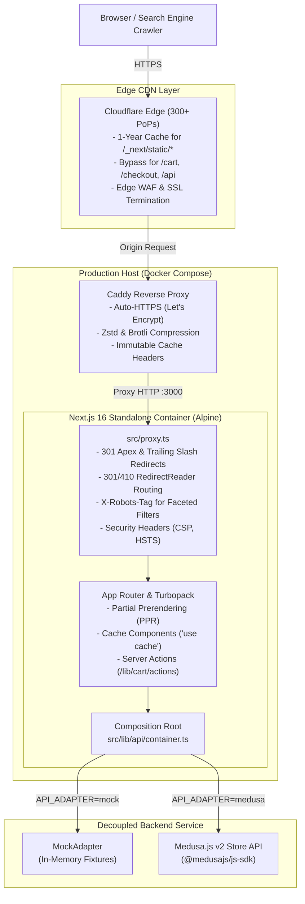
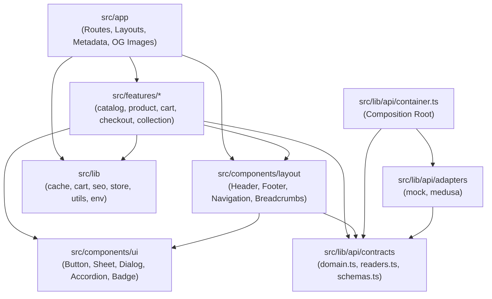
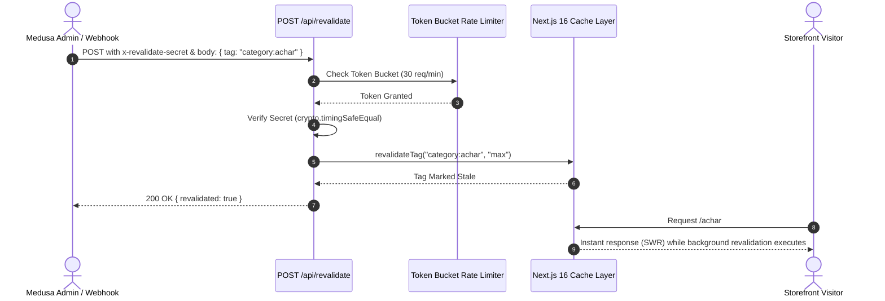

# System Architecture & Engineering Principles

> Comprehensive architectural specification for the **Bramhkanti** storefront (`bramhkanti.com`).

---

## 1. High-Level System Architecture

The following diagram illustrates the request lifecycle, caching layers, and decoupled backend integration:



---

## 2. Directory Layering & Dependency Boundaries

To guarantee that the codebase remains maintainable as new categories, features, and team members arrive, strict architectural boundaries are defined and enforced at build time via `eslint-plugin-boundaries`:



### Boundary Enforcement Rules:

1. **UI Isolation**: `src/components/ui` primitives may **never** import from `features`, `app`, or `adapters`.
2. **Feature Encapsulation**: Features in `src/features/*` may **never** import each other directly. Shared behavior is extracted into `src/lib/` or contracts.
3. **Adapter Isolation**: Adapters in `src/lib/api/adapters` may **only** be imported by `src/lib/api/container.ts`.
4. **SDK Restriction**: `@medusajs/js-sdk` is strictly forbidden across the codebase except within `src/lib/api/adapters/medusa/`.
5. **Environment Access**: `process.env` is restricted via AST linting exclusively to `src/lib/env.ts` (server) and `src/lib/env.public.ts` (client).

---

## 3. SOLID Principles in Practice

| Principle                       | Practical Storefront Implementation                                                                                                                                                                                                              |
| ------------------------------- | ------------------------------------------------------------------------------------------------------------------------------------------------------------------------------------------------------------------------------------------------ |
| **Single Responsibility (SRP)** | Reader interfaces (`ProductReader`, `CategoryReader`, `CollectionReader`, `RedirectReader`, `SearchService`, `CartService`) in `readers.ts` each define one domain query responsibility. UI components render data; server actions mutate state. |
| **Open/Closed (OCP)**           | The catalog routing system and attribute renderer registry (`AttributeRenderer`) are open for extension without modifying existing code. A 4th or 5th category requires zero changes to core routing, schemas, or layouts.                       |
| **Liskov Substitution (LSP)**   | `MockAdapter` and `MedusaAdapter` implement the exact same reader and service interfaces. The application runs with 100% feature parity on either adapter by changing a single environment variable (`API_ADAPTER`).                             |
| **Interface Segregation (ISP)** | Components and Server Components depend only on the narrow reader interface they require (e.g. `CategoryReader` for navigation; `ProductReader` for catalog grids), avoiding bloated god-classes.                                                |
| **Dependency Inversion (DIP)**  | High-level modules (`src/features`, `src/app`) depend strictly on domain abstractions (`src/lib/api/contracts/domain.ts`), never on concrete adapter classes or Medusa API response payloads.                                                    |

---

## 4. Next.js 16 Caching & Invalidation Architecture

Next.js 16 introduces **Cache Components** and fine-grained `'use cache'` directives:



### Cache Taxonomy:

- `catalog`: General catalog listings (stale 5m, revalidate 15m, expire 1d).
- `products`: Product listings and index queries.
- `product:<handle>`: Granular single product page data.
- `categories`: Category tree and navigation (stale 1h, revalidate 2h, expire 7d).
- `category:<slug>`: Specific category hub page and its subcategory lists.
- `collections` / `collection:<handle>`: Curated promotional collection data.
- `redirects`: Legacy 301 and 410 URL mappings (stale 1d, revalidate 1d, expire 30d).

---

## 5. Client State Management Architecture (Zustand v5)

### Core Rules:

1. **Zero Catalog Data in Zustand**: Product lists, category trees, and product details are rendered via React Server Components. Duplicating server state in client stores causes hydration mismatch, memory waste, and stale data bugs.
2. **URL is Single Source of Truth for Filters**: Catalog filters (`minPrice`, `maxPrice`, `sort`, `page`) are managed exclusively through URL `searchParams`. This provides full crawlability, sharable search URLs, and zero-JS functionality via native GET forms.
3. **No Module-Level Singleton Stores**: To prevent cross-request state leakage under Node.js Server-Side Rendering (SSR), stores are constructed per-request using a factory (`createRootStore`) in `StoreProvider.tsx`:

```tsx
// src/lib/store/StoreProvider.tsx
export function StoreProvider({ children }: { children: ReactNode }) {
  // useState lazy initializer guarantees the store is created once per request/mount
  // and is completely safe under React 19 Concurrent Rendering and React Compiler.
  const [store] = useState(() => createRootStore());
  return <StoreContext value={store}>{children}</StoreContext>;
}
```

4. **Ephemeral UI Slices**:
   - `cart-ui`: Drawer open/close state (`isCartOpen`, `openCart`, `closeCart`, `toggleCart`).
   - `toast`: Notification messages with automated TTL dismissal.
   - `search-ui`: Search modal visibility and live query string.
   - `filters-ui`: Mobile filter drawer visibility.
